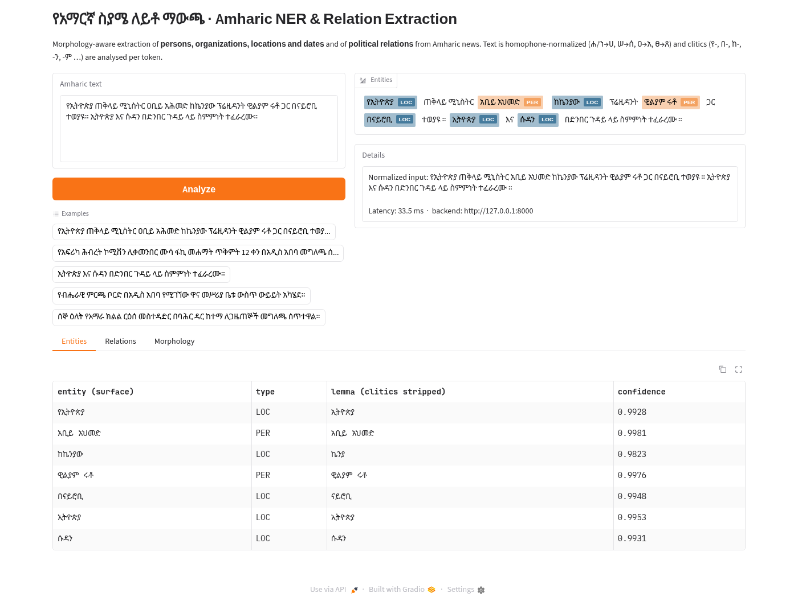

# Process Log: Morphology-Aware Amharic NER & Relation Extraction

This document records **every step** of the project in the order it was done:
what we did, why, the exact command, what came out, and what we learned. All
numbers come from files in `reports/` produced by the code in `src/amner/`.
Anyone in the group should be able to reproduce the whole project with it.

> Quick reproduction: `bash scripts/run_pipeline.sh` (≈2–3 h on an 8-core CPU, no GPU needed).

---

## 0. Project framing

| | |
|---|---|
| **Task** | Named-entity recognition (PER, ORG, LOC, DATE) + political relation extraction from Amharic news |
| **Language** | Amharic (Ge'ez/Fidel script, Semitic, root-and-pattern morphology + clitics) |
| **Required stack** | MasakhaNER, EthioNLP/AmBERTa, spaCy custom pipeline, BIO tagging |
| **Hardware used** | 8-core laptop CPU, 15 GB RAM, **no GPU** |

### Why "morphology-aware"?
Amharic glues function words onto names. One entity appears in many forms:

| surface | analysis | meaning |
|---|---|---|
| ኢትዮጵያ | stem | Ethiopia |
| **የ**ኢትዮጵያ | የ- + stem | of Ethiopia |
| **በ**ኢትዮጵያ | በ- + stem | in Ethiopia |
| ኢትዮጵያ**ን** | stem + -ን | Ethiopia (object) |
| **ለ**ኢትዮጵያ**ም** | ለ- + stem + -ም | also for Ethiopia |

MasakhaNER tags whole whitespace tokens, so `በአዲስ` in `በአዲስ አበባ` is `B-LOC`.
Each inflected form is rarer than the bare name, which hurts recall on unseen
inflections. On top of this, Fidel has **homophone letters** (ሀ/ሐ/ኀ, ሰ/ሠ, አ/ዐ,
ጸ/ፀ), so the same word is spelled several ways. The project handles both problems
explicitly at every stage.

### Backbone choice: about "EthioNLP/AmBERTa"
The brief names `EthioNLP/AmBERTa`. That checkpoint is **not publicly available**
on the Hugging Face Hub (the API returns 401). We therefore use the closest public
equivalent: **`rasyosef/roberta-medium-amharic`**, a RoBERTa (XLM-R architecture)
encoder pre-trained only on Amharic with an Amharic SentencePiece vocabulary
(8 layers, hidden size 512, 41.9 M parameters). It is small enough to fine-tune on
a CPU. Every script takes `--model`/`--base-model`, so swapping in AmBERTa,
`uhhlt/am-roberta`, `Davlan/afro-xlmr-base` or `xlm-roberta-base` needs no code
change.

### Repository map
```
src/amner/
  collect/            1. data collection (BBC scraper, HF benchmarks, Telegram)
  normalize.py        2. Fidel normalization, cleaning, code-switching
  build_corpus.py     2. corpus building, filtering, de-duplication, leakage guard
  morphology.py          clitic analyzer, lexicon, morphology-aware augmentation
  build_lexicon.py       frequency lexicon for the analyzer
  tokenization.py     3. BPE / WordPiece training, tokenizer evaluation, vocab extension
  train_mlm.py        4. domain-adaptive MLM (perplexity before/after)
  train_ner.py        4. NER fine-tuning: full FT or LoRA (PEFT), + augmentation
  evaluate.py         5. seqeval F1, normalization ablation, morphological error analysis
  relations.py           political relation extraction
  evaluate_re.py      5. relation-extraction evaluation
  significance.py     5. paired bootstrap confidence intervals
  select_best.py / summarize.py   model selection by val F1, reports/RESULTS.md
  optimize.py            INT8 dynamic quantization benchmark
  spacy_pipeline.py      spaCy custom pipeline (tokenizer + 3 components)
  service.py / api/ / app/   7. FastAPI backend + Gradio UI
scripts/              run_pipeline.sh, deploy_space.py
eval/re_gold.jsonl    hand-written relation gold set
reports/              every metric, error analysis and figure
tests/                unit tests (pytest)
```

---

## 1. Environment setup

```bash
uv venv --python 3.12 .venv && source .venv/bin/activate
uv pip install --extra-index-url https://download.pytorch.org/whl/cpu torch==2.5.1+cpu
uv pip install -r requirements.txt && uv pip install -e .
pytest -q        # 16 tests, < 1 s
```
Python 3.12 (not the system 3.14) because the PyTorch/spaCy wheels support it.
Note: on our network PyPI downloaded at only ~30 KB/s while the Hugging Face Hub
was fast, so the first install took about 30 minutes.

---

## 2. Stage 1: Data collection

### 2.1 Gold NER data: MasakhaNER 1.0 (Amharic)
`python -m amner.collect.hf_benchmarks`

* The `masakhane/masakhaner` repo uses a legacy *loading script*, which current
  `datasets` versions refuse to run. We read the Hub's automatic **parquet
  conversion** (`refs/convert/parquet` branch) directly instead.
* Splits: **1,750 train / 250 validation / 500 test** sentences, BIO tags
  `O, B/I-PER, B/I-ORG, B/I-LOC, B/I-DATE`.
* Train label counts: LOC 1,050 B-tags, PER 505, DATE 415, ORG 277. ORG is the
  rarest class, and it ends up the hardest one (see §6).
* Saved as JSONL: `data/raw/masakhaner/masakhaner_amh_{split}.jsonl`.

### 2.2 Unlabelled news from the Hub ("official repositories")
Same script, `download_news_text`:
* `masakhane/masakhanews` (amh): 1,311 articles
* `rasyosef/amharic-news-category-classification`: first 8,000 of 49,971 articles (headline + body)

### 2.3 Web scraping: BBC News Amharic (BeautifulSoup)
`python -m amner.collect.bbc_amharic --max-articles 600`

How it works:
1. Fetch `https://www.bbc.com/amharic`, collect topic links (`/amharic/topics/<id>`)
   and article links (`/amharic/articles/<id>`).
2. Walk each topic's `?page=N` pagination to discover more articles (1,939 found).
3. Parse each article with BeautifulSoup: `<h1>` headline, `<time datetime>` date,
   all `<p>` inside `<main>` except captions, asides, nav and footer.
4. Append to `data/raw/bbc_amharic.jsonl` (resumable: known URLs are skipped).

Ethics and politeness: robots.txt is checked with `urllib.robotparser` before
every request, the User-Agent identifies an academic project, and requests are
spaced 1 s apart. **Ethiopian Reporter was deliberately not scraped**: its
robots.txt sets `Content-Signal: ai-train=no`.

Result: **581 articles** (a few timed out or had no body text).

### 2.4 Telegram (Telethon), implemented but not run
`src/amner/collect/telegram_channels.py` scrapes public channels into the same
JSONL schema. It needs personal credentials (`TG_API_ID`, `TG_API_HASH` from
https://my.telegram.org) in `.env`, which is git-ignored. We did not run it
because it would log in with a personal phone number. Any group member can run:
```bash
python -m amner.collect.telegram_channels --channels tikvahethiopia --limit 2000
```
After that, re-run Stage 2 and the messages join the corpus automatically.

---

## 3. Stage 2: Normalization & cleaning

### 3.1 What `normalize.py` does (in order)
1. **`clean_text`**: HTML unescape, strip tags, URLs, e-mails, @mentions/#hashtags,
   emojis and control characters.
2. **`normalize_chars`** (homophones): every vowel order of a family is mapped onto
   the canonical family: **ሐ, ኀ → ሀ; ሠ → ሰ; ዐ → አ; ፀ → ጸ**. The 4th orders ሃ/ሓ/ኃ → ሀ
   and ኣ/ዓ → አ are also merged (they are pronounced the same as the 1st order).
   Two-character labial spellings are folded (ሉዋ → ሏ), along with archaic
   labialized letters (ቍ → ቁ) and Ethiopic digits ፩–፱ → 1–9. Example: `ዐቢይ አሕመድ` → `አቢይ አህመድ`.
3. **`normalize_punct`**: `፡፡` and `::` → `።`; `፡` (old word separator) → space;
   unify quotes and dashes; collapse repeated punctuation; put spaces around
   ። ፣ ፤ ፦ ፧ so they become separate tokens.
4. **`handle_code_switching`**: Latin-script words can be kept (default), tagged
   (`<lat>WHO</lat>`) or dropped. We keep them because names such as *WHO*, *IMF*
   and *TPLF* are often entities. (Bug found and fixed: `\b` does not fire between
   a Fidel letter and a Latin letter because both count as `\w`, so `የWHO` was missed.
   The regex now uses explicit Latin look-arounds.)
5. **Sentence split** on `። ! ? ፧`, then the **filter**: at least 4 tokens and at
   least 60% Ethiopic letters. Dropped lines turned out to be fragments such as
   `ለምን?` ("why?") or `" ብሏል ማኔ` ("Mané said").

### 3.2 Labelled data: alignment-safe normalization
`normalize_token` only maps characters, so the token count never changes and BIO
labels stay aligned. `raw_tokens` is kept beside `tokens` so we can later measure
the effect of normalization (§6.2).

> **7.9% of MasakhaNER train tokens** (2,040 / 25,819) change spelling under
> normalization: that much of the data was fragmented by homophone variation.

### 3.3 Corpus building
`python -m amner.build_corpus`, which writes `reports/corpus_stats.json`:

| | |
|---|---:|
| raw documents | 9,892 |
| raw sentences | 319,937 |
| dropped by filter | 77,326 |
| exact duplicates removed | 7,054 |
| removed for overlapping NER val/test (**leakage guard**) | 0 |
| **kept sentences** | **235,557** (230,846 train / 4,711 held-out) |
| tokens / word types | 4,037,042 / 311,028 |

The leakage guard removes any corpus sentence that is identical to a MasakhaNER
validation/test sentence. This keeps the tokenizer and MLM from seeing test text.
No overlap was found, but the check stays in the pipeline.

---

## 4. Morphology: clitic analysis (used in every later stage)

`src/amner/morphology.py`

* **Prefix clitics**: እንደ-, እስከ-, ወደ-, ስለ-, ከነ-, በነ-, ለነ-, የነ-, ከ-, በ-, ለ-, የ-
* **Suffix clitics**: -ንም, -ውን, -ዋን, -ቱን, -ኛው, -ም, -ን, -ና, -ው, -ዋ
* **Greedy mode** (no lexicon) strips the longest affixes, but over-strips names that
  merely *end* in those syllables: ሱዳን → ሱዳ, ፑቲን → ፑቲ, ኮሚሽን → ኮሚሽ, ለገሠ → ገሰ.
* **Lexicon mode** fixes this with a frequency lexicon of **87,975 words**
  (`python -m amner.build_lexicon`, shipped in `src/amner/resources/`). An
  analysis is accepted only if the stem is a known word (frequency ≥ 3) with at
  least **10%** of the surface form's frequency. Among valid analyses the most
  frequent stem wins.
  * We first required stem frequency ≥ surface frequency. That failed because
    genitives like **የኢትዮጵያ are more frequent than ኢትዮጵያ** in news text, so
    the threshold became relative (0.1). This change alone raised relation-extraction
    F1 from 0.75 to 0.97 on the gold-entity setting (§7).
* Uses: (a) **entity lemmas**: the clitics on the first/last token of an entity are
  removed (`በአዲስ አበባ` → `አዲስ አበባ`); (b) **affix buckets** for error analysis;
  (c) **morphology-aware augmentation**: training sentences are copied with entity
  tokens re-inflected (`ኢትዮጵያ` → `በኢትዮጵያ`, `የአሜሪካ` → `አሜሪካን`). Labels do not
  change because MasakhaNER labels the whole token.

---

## 5. Stage 3: Tokenization

`python -m amner.tokenization`, which writes `reports/tokenizer_eval.json`

* Trained with Hugging Face `tokenizers` on the normalized corpus plus the NER
  train text: **BPE** (Metaspace + punctuation pre-tokenizer) and **WordPiece**,
  both with a 16k vocabulary.
* Evaluated on the held-out corpus and on the entity tokens of the NER test set:

| tokenizer | vocab | fertility ↓ | single-piece % | clitic-boundary recall % |
|---|---:|---:|---:|---:|
| custom BPE | 16,000 | 1.400 | 73.3 | 10.9 |
| custom WordPiece | 16,000 | 1.394 | 73.3 | 8.2 |
| backbone (Amharic SentencePiece) | 32,000 | **1.336** | **77.5** | 34.7 |
| XLM-R (multilingual) | 250,002 | 2.066 | 45.6 | 53.4 |
| backbone + extension | 32,057 | **1.333** | **77.6** | 34.7 |

*Fertility* = subword pieces per word. *Clitic-boundary recall* = how often a
piece boundary falls exactly between a clitic and its stem (294 boundaries checked).

**What we learned**
* The monolingual backbone fragments Amharic far less than multilingual XLM-R
  (1.34 vs 2.07 pieces/word), which confirms the backbone choice.
* Frequency-driven tokenizers learn whole forms like `የኢትዮጵያ` as single units, so
  clitic boundaries are rarely respected. XLM-R "respects" more boundaries only
  because it splits everything. Subwords alone will not handle Amharic clitics,
  which is why we handle morphology explicitly (§4, §6.4).
* **Vocabulary extension**: we add every frequent word (≥ 20 occurrences) that our
  BPE keeps whole but the backbone splits into ≥ 3 pieces. Only **57** qualify,
  and almost all are **normalized spellings** (`ሀይማኖታዊ`, `ከሰአት`, `ልኡል`) that
  the backbone never saw because its pre-training text was not normalized. They are
  added as whole-word tokens. Their embeddings start as the mean of their old pieces
  and are then trained during MLM adaptation.

---

## 6. Stage 4: Fine-tuning & adaptation

### 6.1 Domain-adaptive MLM (continued pre-training)
`python -m amner.train_mlm --extended-tokenizer artifacts/tokenizers/backbone_extended --max-steps 800`

* Masked-LM on the normalized news corpus (15% masking, max length 128,
  batch 32, lr 5e-5, 800 steps ≈ 25,600 sentences, CPU).
* Goal: let the encoder adapt to *normalized* spelling, the new vocabulary rows
  and news/political vocabulary.
* Perplexity on the 4,711 held-out sentences (same masking seed before and after):
  **12.40 → 9.85** (−21%; training loss 2.47, 800 steps in 51 min).
* (The first attempt with 1,500 steps ran at about 4 s/step, roughly 1h45m on CPU,
  so we reduced it to 800 steps.)

### 6.2 NER fine-tuning
`python -m amner.train_ner --model <backbone or artifacts/mlm_dapt> --name <run> [--mode lora] [--morph-augment]`

* Token classification head over 9 BIO labels. Words are split into subwords and
  only the **first subword** of each word carries the label (others are `-100`).
* AdamW, lr 5e-5 (full) / 5e-4 (LoRA), batch 16, warm-up 10%, weight decay 0.01,
  up to 10 epochs, **early stopping** on validation F1 (patience 3), and the best
  checkpoint is restored.
* **LoRA (PEFT)**: rank 16, alpha 32, dropout 0.1 on the attention
  query/key/value and dense projections. The classifier is trained fully. After
  training, adapters are **merged** into the weights so every run loads the same way.
* **Morphology-aware augmentation** (`--morph-augment`): adds one re-inflected
  copy of each training sentence that contains a non-DATE entity (§4).
* The model used for deployment is chosen by **validation** F1, never by test F1
  (`python -m amner.select_best`).

### 6.3 Runs

| run | starting encoder | method | trainable params | epochs (early stop) | train time (CPU) |
|---|---|---|---:|---:|---:|
| `base_full` | original backbone | full fine-tuning | 41.9 M (100%) | 7 | 11.6 min |
| `base_full_morph` | original backbone | full FT + morph. augmentation | 41.9 M (100%) | 8 | 15.8 min |
| `dapt_full` | MLM-adapted | full fine-tuning | 41.9 M (100%) | 7 | 9.1 min |
| `dapt_lora` | MLM-adapted | **LoRA** r=16 | **1.18 M (2.83%)** | 8 | 7.3 min |
| `dapt_full_morph` | MLM-adapted | full FT + morph. augmentation | 41.9 M (100%) | 9 | 17.2 min |

Exact per-run settings and numbers: `reports/runs/<run>.json`. Validation F1 per
epoch for the baseline climbed 0.645 → 0.715 → 0.729 → **0.782** (epoch 4), then
plateaued, and early stopping ended it at epoch 7.

**Selected for deployment (best validation F1): `dapt_full`** (val 0.789).

---

## 7. Stage 5: Evaluation

### 7.1 NER metrics
`python -m amner.evaluate --model artifacts/ner/<run> --name <run>`
* Entity-level micro precision/recall/F1 with `seqeval` (CoNLL style), plus
  **strict IOB2** F1 and per-type scores.
* **Normalization ablation**: the same model is run on the *raw* MasakhaNER
  tokens instead of the normalized ones.

MasakhaNER Amharic **test set** (500 sentences, 558 gold entities):

| run | val F1 | test P | test R | **test F1** [95% CI] | strict F1 | F1 on *un-normalized* input |
|---|---:|---:|---:|---:|---:|---:|
| base_full | 0.782 | 0.746 | 0.774 | **0.760** [0.724, 0.794] | 0.771 | 0.757 |
| base_full_morph | 0.773 | 0.701 | 0.776 | 0.736 [0.698, 0.772] | 0.748 | 0.727 |
| dapt_full ★ | **0.789** | 0.733 | **0.790** | **0.760** [0.721, 0.795] | **0.776** | 0.757 |
| dapt_lora | 0.787 | 0.708 | 0.755 | 0.730 [0.692, 0.765] | 0.748 | 0.721 |
| dapt_full_morph | 0.785 | 0.728 | 0.753 | 0.740 [0.703, 0.772] | 0.750 | 0.737 |

Per type (F1): PER ≈ 0.83–0.86, LOC ≈ 0.77–0.81, DATE ≈ 0.64–0.73,
**ORG ≈ 0.50–0.58** (the hardest type: rarest in training, long multi-word names).

**Significance.** `python -m amner.significance` runs a paired bootstrap
(2,000 resamples of test sentences):

| vs. base_full | Δ F1 | 95% CI | verdict |
|---|---:|---|---|
| dapt_full | +0.0005 | [−0.021, +0.020] | no difference |
| dapt_lora | −0.0296 | [−0.056, −0.005] | **significantly worse** |
| dapt_full_morph | −0.0198 | [−0.044, +0.003] | worse (borderline) |
| base_full_morph | −0.0235 | [−0.048, +0.000] | worse (borderline) |

**Interpretation**
* **MLM adaptation** clearly worked as language modelling (perplexity 12.40 → 9.85),
  but did *not* move NER F1. It raised recall (0.774 → 0.790) and lowered
  precision. The backbone was already pre-trained on Amharic news, and 800 CPU
  steps (~26k sentences) is a small adaptation budget.
* **LoRA** matches full fine-tuning on *validation* (0.787 vs 0.789) while training
  only 2.8% of the weights and finishing fastest, but it generalizes worse to
  the test set. With 1,750 sentences, updating all weights is still affordable and
  better. LoRA's advantage is memory/storage (a ~5 MB adapter instead of a
  168 MB model), which matters for GPU-less or multi-task settings.
* **Normalization at inference** helps every model a little (e.g. 0.757 → 0.760).
  The effect is small because the test set is mostly in standard spelling, but
  it is consistent across all five runs.

### 7.2 Morphological error analysis
Every gold entity is put into buckets, and recall is reported per bucket:
* **affix**: bare / prefix / suffix / prefix+suffix (lexicon analyzer);
* **novelty**: *seen surface* (exact form in training), *unseen surface but seen
  stem* (a new inflection of a known name, e.g. `ለኢትዮጵያ` when only `ኢትዮጵያ` was
  seen), and *unseen*.

Errors are classified as missed, spurious, boundary, boundary+type and type
confusion. Examples (with full sentences) are in
`reports/eval/error_analysis_<run>.md`.

Recall per bucket (`reports/eval/<run>.json`, column n = gold entities):

| bucket | n | base_full | base_full_morph | dapt_full | dapt_lora | dapt_full_morph |
|---|---:|---:|---:|---:|---:|---:|
| affix: bare | 315 | 0.778 | 0.787 | 0.787 | 0.775 | 0.765 |
| affix: **prefix** (የ-/በ-/ለ-/ከ-…) | 210 | 0.767 | 0.757 | **0.795** | 0.733 | 0.733 |
| affix: suffix | 25 | 0.800 | 0.800 | 0.800 | 0.720 | 0.760 |
| novelty: seen surface | 160 | 0.894 | 0.887 | 0.906 | 0.844 | 0.869 |
| novelty: **unseen surface, seen stem** | 35 | 0.714 | **0.771** | **0.771** | **0.829** | 0.686 |
| novelty: unseen | 363 | 0.727 | 0.727 | 0.741 | 0.708 | 0.708 |

**What the morphological analysis shows**
1. **The morphological gap is real.** For the baseline, an entity whose exact form
   was in training is found 89% of the time, but a *new inflection of a known
   name* only 71%, the same as a completely unseen name (73%). The model does not
   automatically transfer `ኢትዮጵያ` to `ለኢትዮጵያ`.
2. **Prefixed entities are the main failure group.** In the baseline, most
   "missed" examples carry a proclitic: `የህወሀት` (of TPLF), `በንጃሜና` (in N'Djamena),
   `የአፕል` (of Apple), `የፌስቡክ` (of Facebook), `የኢሬቻ በአል` (the Irreecha festival).
   The genitive `የ-` turns a name into a modifier, and the model often then tags
   it as O.
3. **MLM adaptation closes most of the prefix gap**: recall on prefixed entities
   0.767 → 0.795 (now equal to bare entities) and on new inflections 0.714 → 0.771.
4. **Augmentation does what it was designed for, but at a price.** On the original
   backbone it raises recall on new inflections (0.714 → 0.771) and on PER
   (F1 0.829 → 0.857) and cuts *missed* entities from 48 to 36. But *spurious*
   predictions rise from 60 to 84, so precision falls (0.746 → 0.701). Looking at
   the "spurious" list (`reports/eval/error_analysis_base_full_morph.md`),
   many are arguably real entities that the gold annotation leaves as O: `ትዊተር`
   (Twitter), `ዋትስአፕ` (WhatsApp), `ስካይፕ` (Skype), `ከፌደራል ማረሚያ ቤቶች ኮሚሽን`
   (Federal Prisons Commission). Part of the measured precision loss is
   therefore annotation inconsistency. Augmentation also creates some unnatural
   forms (e.g. `ወደ` "towards" in front of a person name), which we would filter
   by entity type in a next iteration.
5. The bucket with new inflections has only **35 entities**, so per-bucket
   differences are indicative, not conclusive.

Error taxonomy (baseline → selected model `dapt_full`): missed 48 → 39,
boundary 47 → 48, boundary+type 20 → 18, type confusion 11 → 12, spurious 60 → 69.
The most frequent confusion is LOC ↔ ORG/PER (for example a region name used for
its government).

### 7.3 Relation extraction
`python -m amner.evaluate_re --model artifacts/ner/best`

There is no public Amharic relation-extraction dataset, so we wrote a
**25-sentence diagnostic set** (`eval/re_gold.jsonl`, 55 gold relations) in news
style. It covers every relation type, includes negative sentences and
deliberately hard cases (a person's "counterpart", a polity glued to the title,
"discussed the implementation of the *agreement*", which is a meeting and not a signing).

| setting | precision | recall | F1 |
|---|---:|---:|---:|
| gold entities, **greedy** clitic analyzer (ablation) | 0.833 | 0.818 | 0.826 |
| gold entities, **lexicon** clitic analyzer | **0.982** | **0.964** | **0.973** |
| end-to-end (entities from `dapt_full`) | 0.808 | 0.691 | 0.745 |

* The only difference between the first two rows is the clitic analyzer. Greedy
  stripping produces wrong argument names (`ሱዳ`, `ፑቲ`, `ገሰ ቱሉ`), so
  **morphology directly decides relation quality**.
* End-to-end, recall drops because missed or mis-bounded entities remove their
  relations. Precision stays above 0.8.
* Remaining gold-entity errors (`reports/eval/relation_errors.md`): an
  appositive title separated from the polity by an extra phrase (`የአሜሪካ የውጭ
  ጉዳይ ሚኒስትር` "US Foreign Minister" → MEMBER_OF missed), and `የተባበሩት` (in
  "United Nations") is not stripped because `ተባበሩት` almost never occurs alone.

**Honest caveat:** the relation patterns were refined while looking at this set,
so it is effectively a *development* set and the gold-entity score is optimistic.
The end-to-end score is more realistic. A separate held-out RE test set annotated
by the native speakers in our group would be the next step.

Relation rules (`src/amner/relations.py`), in short:
1. **Title apposition**: `የ<ORG/LOC> <TITLE> <PER>` gives LEADER_OF / SPOKESPERSON_OF /
   MEMBER_OF, and also HOLDS_TITLE. 25 titles (ጠቅላይ ሚኒስትር, ፕሬዚዳንት,
   ሊቀመንበር, ርዕሰ መስተዳድር, ቃል አቀባይ, …). A title can carry clitics
   (`የጠቅላይ`, `ሊቀመንበሩ`).
2. **Verb-final clauses** (Amharic is SOV): MET_WITH / AGREEMENT_WITH /
   CONFLICT_WITH need a trigger *after* the second entity, and that entity must be
   marked as a participant (`ከ-` prefix or `ጋር` "with", coordination with `እና`, or
   `በX እና በY መካከል` "between X and Y").
3. **Clitics carry roles**: an entity with `በ-` ("in/at") is a *venue*, not a party.
   A LOC/ORG directly before a person (`ከሩሲያው አቻቸው ቭላድሚር ፑቲን`) is a
   modifier, not a participant. A polity already used by a title is not reused.
4. **Fused-suffix trigger matching**: Amharic suffixes fuse with the last syllable
   (`ጦርነት` + -u = `ጦርነቱ` "the war"), so triggers match on the *consonant
   family* of their last syllable (Unicode Fidel blocks are 8 code points per
   consonant).
5. LOCATED_IN (`ውስጥ`, `የሚገኘው`, or `የ<LOC> <ORG>`) and EVENT_DATE (nearest PER/ORG
   to a DATE, followed by a statement/event verb).

### 7.4 Optimization (inference)
`python -m amner.optimize --model artifacts/ner/best`

PyTorch dynamic INT8 quantization of all `nn.Linear` layers, 4 CPU threads,
on the selected model:

| variant | size | latency per sentence (batch 1) | throughput (batch 32) | test F1 |
|---|---:|---:|---:|---:|
| FP32 | 167.7 MB | 21.4 ms | 90 sent/s | 0.7603 |
| **INT8 dynamic** | **92.2 MB** | **9.1 ms** | **204 sent/s** | 0.7517 |

**2.35× faster, 1.82× smaller, −0.009 F1.** For an interactive web app this is a
good trade, so the API and UI serve the INT8 model by default
(`service.get_pipeline(quantize=True)`).

---

## 8. Stage 7: System deployment

### 8.1 spaCy custom pipeline
`src/amner/spacy_pipeline.py`, built on `spacy.blank("am")`:

| component | role |
|---|---|
| `AmharicTokenizer` | runs the full normalizer, then splits words and Ethiopic punctuation (`doc.text` is the normalized text; the raw input is kept in `doc.user_data["raw"]`) |
| `amharic_morphology` | sets `token._.prefix / ._.stem / ._.suffix` |
| `amharic_ner` | transformer BIO tagger → `doc.ents`, `span._.lemma_am`, `span._.score` |
| `amharic_relations` | rule-based relations → `doc._.relations` |

Gotcha: this module must **not** use `from __future__ import annotations`. spaCy
validates factory signatures at runtime with pydantic and fails on string
annotations (`ConfigError: field "nlp" not yet prepared`).

### 8.2 FastAPI backend
```bash
uvicorn api.main:app --port 8000      # docs at http://127.0.0.1:8000/docs
```
Endpoints: `GET /health`, `POST /analyze {"text": ...}`, `POST /analyze/batch`, `POST /normalize`, `POST /tokenize`.
The response contains the normalized text, entities (surface, type, lemma,
confidence, offsets), relations, a per-token morphology table and the latency.
The model loads once at start-up, with INT8 quantization on by default.

### 8.3 Gradio UI
```bash
AMNER_API_URL=http://127.0.0.1:8000 python app/gradio_app.py   # client of the API
python app/gradio_app.py                                        # or in-process
```
Highlighted entities, plus tabs for entities, relations and the morphology table,
with five example sentences. Verified end-to-end (UI → API → spaCy → model):
the screenshot `docs/ui_demo.png` was taken from the running system.



### 8.4 Explainability tabs, TensorBoard and rehearsal
* **Normalization tab** (`POST /normalize`, `amner.explain.normalization_diff`): the raw input
  with every character the normalizer re-spells highlighted with its rule (`ሕ→ህ`, `ዐ→አ`, …),
  removed noise (URLs, mentions, emojis), the cleaned text, a change table and a summary.
* **Tokenizer tab** (`POST /tokenize`, `amner.explain.tokenizer_comparison`): the subword
  splits of the backbone, the extended backbone, our BPE and WordPiece and XLM-R for any
  word or phrase, next to the clitic segmentation (prefix + stem + suffix). Example:
  every tokenizer keeps `ለኢትዮጵያ` whole, while the analyser gives `ለ + ኢትዮጵያ + ንም`;
  XLM-R shatters `ከኬንያው` into 4 pieces.
* **TensorBoard**: `train_ner`/`train_mlm` now log with `report_to=["tensorboard"]` to
  `runs/<run>` when the package is installed. The five NER runs and the MLM run were
  trained before that, so `python -m amner.tb_export` rebuilt their curves from the
  Trainer's logged metric dictionaries (no retraining). The event files (72 KB) are
  committed; `tensorboard --logdir runs` shows loss, learning rate, gradient norm and
  validation P/R/F1 per epoch for all runs.
* **Rehearsal**: `bash scripts/launch_demo.sh --tb` starts API, UI and TensorBoard;
  `python scripts/rehearse_demo.py` exercises all 4 API endpoints and all UI tabs.
  Result: **8/8 checks passed** (analyze ≈ 0.4 s, normalize ≈ 4 ms, tokenize ≈ 1.1 s on first call).

### 8.5 Hugging Face Spaces
`python scripts/deploy_space.py` (after `huggingface-cli login` with a *write* token)
uploads the model to a model repo and deploys the same Gradio app as a Space that
downloads the model at start-up (the custom tokenizer files are shipped with it for the Tokenizer tab).

Status: the Space was **not** deployed in this submission (the group chose to
deploy later). The script and model are ready; run it after logging in.

---

## 9. Limitations & future work
* **Data size**: 1,750 training sentences. ORG is the weakest type (rare, and
  multi-word with internal clitics).
* **Clitic analyzer** is string-based. Fused forms (ቤት + -u → ቤቱ, ፕሬዚዳንቱ) and
  colloquial vowel fusion (በ + አዲስ → ባዲስ) are not analyzed. A full analyzer
  such as HornMorpho could be plugged into `MorphAnalyzer`.
* **Relations** are rule-based and assessed on a small development set (see §7.3).
* **Compute**: everything ran on a CPU, so MLM adaptation saw only ~26k sentences.
  More steps on a GPU would likely help more.
* Telegram data was not included (credentials), see §2.4.

## 10. Who can run what (group of four)
Every stage is an independent command, so group members can each own a stage:
data (§2–3), tokenization and morphology (§4–5), training (§6), evaluation and
deployment (§7–8). `scripts/run_pipeline.sh` runs everything in order.
