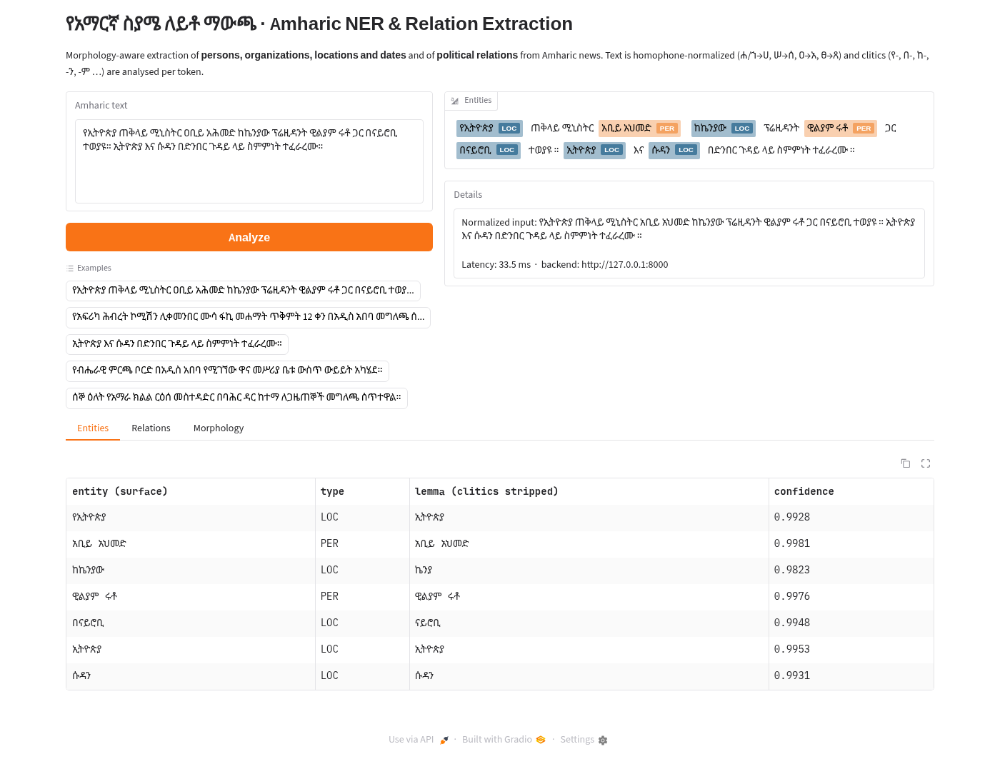

# Morphology-Aware Amharic NER & Relation Extraction

End-to-end NLP pipeline that extracts **persons, organizations, locations and
dates** and **political relations** (who leads what, who met whom, who signed
with whom, …) from Amharic news. It is designed around two properties of
Amharic: Fidel **homophone spelling variation** and **clitics glued onto names**
(`በአዲስ አበባ`, `የኢትዮጵያ`, `ኢትዮጵያን`).

```
scrape / download ─► normalize & clean ─► tokenizers ─► MLM adaptation ─► NER fine-tuning (full / LoRA, + morph. augmentation)
                                                                          │
                       FastAPI ◄─ spaCy pipeline (normalizer · morphology · NER · relations) ◄─ evaluation & error analysis
                          │
                       Gradio UI
```

📄 **[PROCESS.md](PROCESS.md)** documents every step in detail, with commands, design decisions and results.
📊 **[reports/RESULTS.md](reports/RESULTS.md)** collects all metrics. Error analyses are in `reports/eval/`.

## Results at a glance

| | |
|---|---|
| Corpus | 235,557 normalized sentences (4.0 M tokens): 581 scraped BBC Amharic articles + 9,311 Hub news articles |
| Normalization | 7.9% of MasakhaNER tokens change spelling under homophone folding |
| Tokenizers | Amharic SentencePiece backbone: 1.34 pieces/word vs 2.07 for XLM-R; 57 normalized words added to its vocabulary |
| MLM adaptation | held-out perplexity **12.40 → 9.85** |
| **NER (MasakhaNER amh test)** | **F1 0.760** [95% CI 0.72–0.80], P 0.733, R 0.790 (selected model `dapt_full`) |
| Morphology | recall on prefixed entities 0.767 → **0.795** and on new inflections of known names 0.714 → **0.771** after adaptation |
| LoRA | 2.8% of weights trainable, val F1 0.787 (≈ full FT), test F1 0.730 |
| Relations | F1 **0.973** with gold entities (0.826 without the clitic lexicon), **0.745** end-to-end |
| Serving | INT8: 9.1 ms/sentence, 2.35× faster, 1.8× smaller, −0.009 F1 |



## Quick start

```bash
uv venv --python 3.12 .venv && source .venv/bin/activate
uv pip install --extra-index-url https://download.pytorch.org/whl/cpu torch==2.5.1+cpu
uv pip install -r requirements.txt && uv pip install -e .
pytest -q

bash scripts/run_pipeline.sh          # full reproduction (~2–3 h on CPU)
```

Serve the trained model:

```bash
uvicorn api.main:app --port 8000                                   # REST API, docs at /docs
AMNER_API_URL=http://127.0.0.1:8000 python app/gradio_app.py       # web UI at :7860
```

```bash
curl -s localhost:8000/analyze -H 'content-type: application/json' \
  -d '{"text":"የኢትዮጵያ ጠቅላይ ሚኒስትር ዐቢይ አሕመድ ከኬንያው ፕሬዚዳንት ዊልያም ሩቶ ጋር በናይሮቢ ተወያዩ።"}'
```

Use it as a spaCy pipeline:

```python
from amner.spacy_pipeline import build_pipeline
nlp = build_pipeline("artifacts/ner/best")
doc = nlp("ኢትዮጵያ እና ሱዳን በድንበር ጉዳይ ላይ ስምምነት ተፈራረሙ።")
[(e.text, e.label_, e._.lemma_am) for e in doc.ents], doc._.relations
```

Deploy to Hugging Face Spaces (needs `huggingface-cli login` with a write token):

```bash
python scripts/deploy_space.py
```

## Pipeline stages

| # | Stage | Code | Main techniques |
|---|---|---|---|
| 1 | Data collection | `amner.collect.*` | BeautifulSoup scraper (BBC News Amharic, robots-aware), MasakhaNER + news corpora from the HF Hub, Telethon scraper (optional) |
| 2 | Normalization & cleaning | `amner.normalize`, `amner.build_corpus` | ሀ/ሐ/ኀ, ሰ/ሠ, አ/ዐ, ጸ/ፀ homophone folding, labial and digit folding, noise stripping, code-switching policy, de-duplication, test-leakage guard |
| 3 | Tokenization | `amner.tokenization` | BPE and WordPiece (HF `tokenizers`), fertility and clitic-boundary evaluation, backbone vocabulary extension |
| 4 | Adaptation | `amner.train_mlm`, `amner.train_ner` | domain-adaptive MLM, full fine-tuning vs **LoRA (PEFT)**, **morphology-aware augmentation**, BIO tagging |
| 5 | Evaluation | `amner.evaluate`, `amner.evaluate_re` | seqeval F1 (default + strict), per type, normalization ablation, perplexity, **morphological error buckets** |
| 6 | Relations | `amner.relations` | SOV/clitic-aware patterns: LEADER_OF, MET_WITH, AGREEMENT_WITH, CONFLICT_WITH, LOCATED_IN, EVENT_DATE … |
| 7 | Deployment | `amner.spacy_pipeline`, `api/`, `app/` | spaCy custom pipeline, FastAPI, Gradio, INT8 quantization, HF Spaces script |

## Backbone

The brief names `EthioNLP/AmBERTa`, which is not publicly available on the Hub.
We use the public Amharic-only RoBERTa **`rasyosef/roberta-medium-amharic`**.
Any Hub encoder can be swapped in with `--model` / `--base-model`.

## Data & licences

MasakhaNER, MasakhaNEWS and
`rasyosef/amharic-news-category-classification` are downloaded from the Hub at
run time and not redistributed (see each dataset card for its licence). BBC articles were scraped politely for
research and are not redistributed either. Only a 200-sentence sample of the
cleaned corpus and the word-frequency lexicon are committed.
