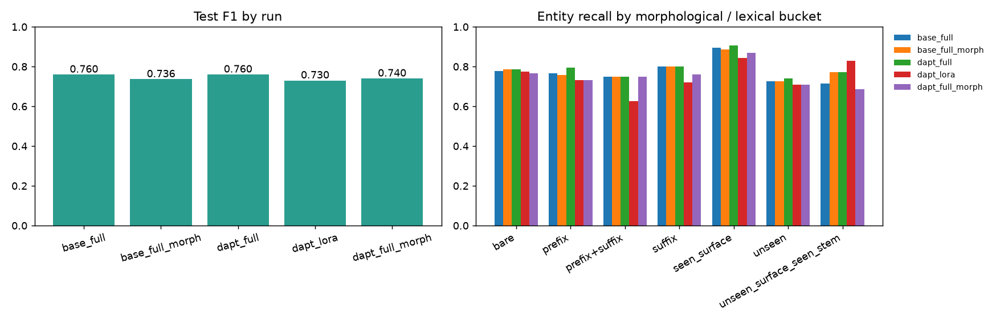

# Results

All numbers are produced by the scripts in `src/amner`; see PROCESS.md for how.

## Corpus

- documents: 9892, sentences kept: 235557 (train 230846, valid 4711), tokens: 4,037,042, types: 311,028
- per source: {'bbc_amharic': 16309, 'masakhane/masakhanews': 35461, 'rasyosef/amharic-news-category-classification': 183787}
- dropped: filter 77326, duplicates 7054, overlap with NER val/test 0

## Tokenizers (held-out corpus + NER test entities)

| tokenizer | vocab | fertility ↓ | single-piece % ↑ | clitic-boundary recall % ↑ |
|---|---:|---:|---:|---:|
| custom_bpe | 16,000 | 1.4 | 73.34 | 10.88 |
| custom_wordpiece | 16,000 | 1.394 | 73.32 | 8.16 |
| backbone:rasyosef/roberta-medium-amharic | 32,000 | 1.336 | 77.47 | 34.69 |
| compare:xlm-roberta-base | 250,002 | 2.066 | 45.64 | 53.4 |
| backbone_extended | 32,057 | 1.333 | 77.59 | 34.69 |

## MLM adaptation (mlm_dapt)

Perplexity on held-out news: **12.4 → 9.85** (800 steps, 3039.5 s, vocab 32,057)

## NER (MasakhaNER Amharic test set, entity-level micro scores)

| run | description | trainable params | val F1 | test P | test R | **test F1** | strict F1 | F1 on un-normalized input | train time |
|---|---|---:|---:|---:|---:|---:|---:|---:|---:|
| base_full | Backbone, full fine-tuning | 41,871,369 (100.0%) | 0.7820 | 0.7461 | 0.7742 | **0.7599** | 0.7714 | 0.7566 | 11.6 min |
| base_full_morph | Backbone, full FT + morphology-aware augmentation | 41,871,369 (100.0%) | 0.7728 | 0.7006 | 0.7760 | **0.7364** | 0.7483 | 0.7274 | 15.8 min |
| dapt_full | Domain-adapted (MLM) backbone, full fine-tuning | 41,900,553 (100.0%) | 0.7892 | 0.7326 | 0.7903 | **0.7603** | 0.7757 | 0.7571 | 9.1 min |
| dapt_lora | Domain-adapted backbone, LoRA (PEFT) | 1,184,265 (2.83%) | 0.7868 | 0.7076 | 0.7545 | **0.7303** | 0.7480 | 0.7210 | 7.3 min |
| dapt_full_morph | Domain-adapted, full FT + morphology-aware augmentation | 41,900,553 (100.0%) | 0.7848 | 0.7279 | 0.7527 | **0.7401** | 0.7502 | 0.7367 | 17.2 min |

### Per-type F1

| run | PER | ORG | LOC | DATE |
|---|---:|---:|---:|---:|
| base_full | 0.8288 | 0.5562 | 0.8060 | 0.7264 |
| base_full_morph | 0.8571 | 0.5167 | 0.7729 | 0.7070 |
| dapt_full | 0.8355 | 0.5799 | 0.8051 | 0.7000 |
| dapt_lora | 0.8421 | 0.5000 | 0.7851 | 0.6425 |
| dapt_full_morph | 0.8502 | 0.5333 | 0.7651 | 0.7282 |

### Recall by morphological bucket

| bucket | n | base_full | base_full_morph | dapt_full | dapt_lora | dapt_full_morph |
|---|---:|---:|---:|---:|---:|---:|
| affix:bare | 315 | 0.778 | 0.787 | 0.787 | 0.775 | 0.765 |
| affix:prefix | 210 | 0.767 | 0.757 | 0.795 | 0.733 | 0.733 |
| affix:prefix+suffix | 8 | 0.750 | 0.750 | 0.750 | 0.625 | 0.750 |
| affix:suffix | 25 | 0.800 | 0.800 | 0.800 | 0.720 | 0.760 |
| novelty:seen_surface | 160 | 0.894 | 0.887 | 0.906 | 0.844 | 0.869 |
| novelty:unseen | 363 | 0.727 | 0.727 | 0.741 | 0.708 | 0.708 |
| novelty:unseen_surface_seen_stem | 35 | 0.714 | 0.771 | 0.771 | 0.829 | 0.686 |

### Is the difference real? (paired bootstrap, 2,000 resamples of the 500 test sentences)

| run | test F1 [95% CI] | Δ vs base_full [95% CI] | P(better than base) |
|---|---|---|---:|
| base_full | 0.7599 [0.724, 0.794] | +0.0000 [+0.000, +0.000] | 0.0 |
| base_full_morph | 0.7364 [0.698, 0.772] | -0.0235 [-0.048, +0.000] | 0.026 |
| dapt_full | 0.7603 [0.721, 0.795] | +0.0005 [-0.021, +0.020] | 0.526 |
| dapt_lora | 0.7303 [0.692, 0.765] | -0.0296 [-0.056, -0.005] | 0.011 |
| dapt_full_morph | 0.7401 [0.703, 0.772] | -0.0198 [-0.044, +0.003] | 0.043 |

## Relation extraction (25-sentence diagnostic set)

| setting | P | R | F1 |
|---|---:|---:|---:|
| gold_entities_greedy_analyzer | 0.833 | 0.818 | 0.826 |
| gold_entities | 0.982 | 0.964 | 0.973 |
| end_to_end | 0.808 | 0.691 | 0.745 |

## Inference optimization (CPU, dynamic INT8 quantization)

| variant | size MB | latency ms/sentence (bs=1) | throughput sent/s (bs=32) | test F1 |
|---|---:|---:|---:|---:|
| fp32 | 167.7 | 21.39 | 90.1 | 0.7603 |
| int8_dynamic | 92.2 | 9.09 | 203.9 | 0.7517 |

Speed-up 2.35×, size reduction 1.82×, F1 change -0.0086.
